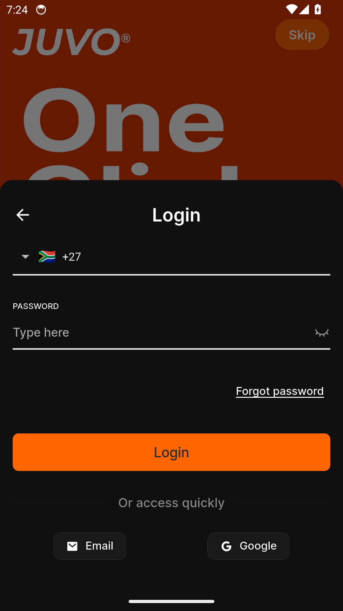
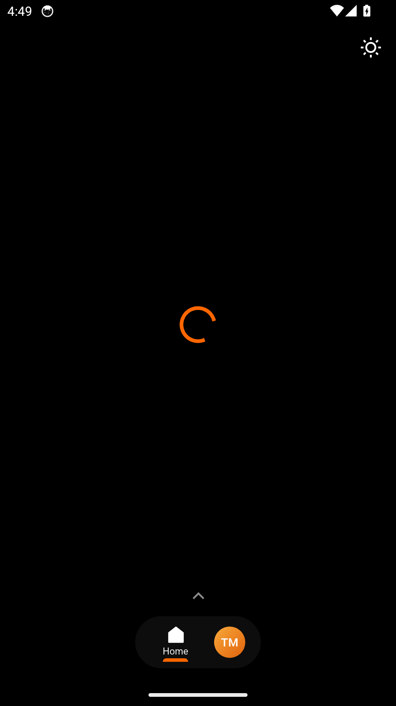
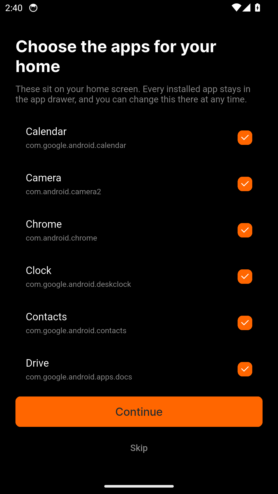

# Launcher — Feature Guide

A minimal launcher that keeps your phone simple

> This guide is generated automatically on every merge: CI builds the
> app, walks the guided tour on an Android emulator, and captures
> each screen below.

## 1. Welcome to Launcher

Launcher is your phone, simplified - sign in to get started.

## 2. Sign in

Signing in to Launcher is quick and simple.

## 3. Create an account

New to Launcher? Create your account in a few easy steps.

## 4. Reset your password

Forgot your password? Launcher gets you back in with a secure reset.

## 5. Your apps, one clean screen

Everything you need and nothing you don't - your apps on one calm screen.

## 6. Every app, one swipe up

Home stays short. Every installed app lives in the drawer, one swipe up, with
search.

## 7. Choose what sits on home

First run asks three small things: make this your home screen, pick the apps for
home, and sign in. Every one can be skipped.

## 8. Your account at a glance

Your name, role and details - your account in one clean card.
